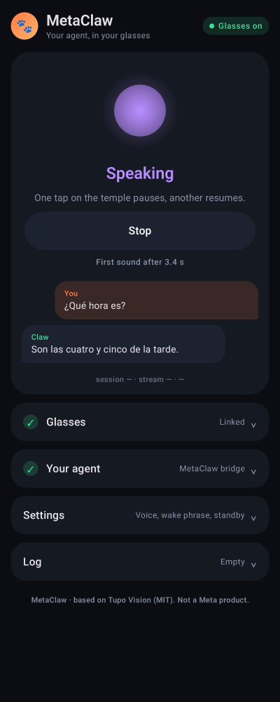

# MetaClaw 🐾🕶️

**Talk to your own AI agent through Ray-Ban Meta glasses.** Say *"hey Claw"* or *"oye Claw"*,
ask, and the answer comes back through the glasses speakers. Ask *"what am I looking at?"* and a
picture from the glasses camera goes along with the question.

MetaClaw listens for its own wake phrase, so it does not take over "Hey Meta". While a MetaClaw
conversation is running, though, the app holds the glasses microphone as a Bluetooth call, and the
glasses do not answer "Hey Meta" during a call. Stop MetaClaw and "Hey Meta" works again.

<p align="center"></p>

MetaClaw is a fork of **[Tupo Vision](https://github.com/KeonyRus/tupo_vision)** by KeonyRus
(MIT). Tupo Vision did the hard part: the glasses connection through Meta's official toolkit,
camera frames, temple-tap control and the background service that keeps it all alive with the
phone in a pocket. MetaClaw adds a third brain next to its ChatGPT and Gemini modes: **your
own agent**, reached through a small bridge on your own machine. See [Credits and
licenses](#credits-and-licenses).

> **Status: early.** First runs on real glasses work; expect rough edges. Not
> affiliated with Meta, OpenClaw, OpenAI or Google.

## How it works

```
Ray-Ban Meta ──Bluetooth──▶ Android phone (MetaClaw) ──private network──▶ bridge ──▶ your agent
   mic, camera,               speech recognition,         e.g. Tailscale      metaclaw-bridge.mjs   OpenClaw or
   speakers                   wake phrase, TTS                                                       anything else
```

1. The phone listens through the glasses microphone with Android speech recognition.
2. Phrases without the wake phrase are ignored. "Hey Claw, …" or "Oye Claw, …" becomes a question.
3. If the question is about what you see ("mira", "esto", "lee", "look", "this", "read"…), or
   photo mode is on, a camera frame from the glasses goes with it.
4. The app sends it to the **bridge** (`POST /ask`, bearer token). The bridge runs a command
   you choose, which asks your agent and prints the answer.
5. The phone speaks the answer through the glasses. If the agent takes more than four seconds,
   it says "Un momento" / "One moment" first, so silence is not mistaken for a hang.

The original Tupo Vision modes (GPT on a ChatGPT plan, Gemini Live) are still there: switch off
"Answer with my agent" in the app.

### Wake phrase

Default: `hey claw, oye claw` (editable, comma separated; empty = answer everything).

**Offline (default).** While waiting, the phone runs a small Spanish [Vosk](https://alphacephei.com/vosk/)
model that only knows a few dozen words: "hey", "oye", the name as it hears it (*clo*, *clau*)
and look-alikes such as *claro*, *clausura* or *cola*, so everyday speech lands on those. No
audio leaves the phone until it hears the phrase. Then it **beeps**, and Android's speech
recognition takes your question: say "Oye Claw", wait for the beep, then ask.
`tools/wake_test.py` checks the rule on synthetic voices: 124/129 right, no false wake in 96
look-alike sentences (the misses are US English voices). Real voices through the glasses
microphone are still to be tested.

**Without the model** (switch "Offline wake phrase" off, or a build without it), the wake phrase
rides on Android's continuous speech recognition. Spanish recognition rarely writes "Claw": it
hears *clo*, *clau*, *claus*… and "hey" comes back as *ey* or *hei*. The app folds those before
matching, so "Oye, Claus, ¿qué hora es?" works in one go, at the cost of more battery and,
depending on the phone, audio going to Google's recognizer.

## What you need

- Ray-Ban Meta glasses paired with the **Meta AI** app, with **Developer Mode** on
  (Meta AI → Settings → App info → tap the version five times). With Developer Mode the toolkit
  skips attestation, so no Wearables Developer Center registration is needed for a personal build.
- An Android phone, Android 12 or newer.
- A machine that runs the bridge (Node 18+) and can reach your agent, on a private network
  the phone can also reach (Tailscale works well).

## Setup

### 1. Bridge

```bash
export METACLAW_TOKEN=$(openssl rand -hex 24)       # keep it, the app needs it
export METACLAW_AGENT_CMD=$PWD/bridge/examples/echo-agent.sh   # start with the echo agent
export METACLAW_HOST=100.x.y.z                       # your Tailscale IP, never 0.0.0.0 on a public host
node bridge/metaclaw-bridge.mjs
```

The command gets the question as its first argument and these variables:

| Variable | Content |
|---|---|
| `METACLAW_IMAGE` | path to a JPEG from the glasses camera, or empty |
| `METACLAW_CONVERSATION_ID` | same value for every question of one conversation |
| `METACLAW_LANGUAGE` | phone language tag, e.g. `es-ES` |
| `METACLAW_LOCATION` | `lat,lon,accuracy_m,age_s` of the phone, or empty (switch "Send my location" off, no permission, no fix) |

Whatever it prints on stdout is spoken. For OpenClaw use
[`bridge/examples/openclaw-agent.sh`](bridge/examples/openclaw-agent.sh), which calls
`openclaw agent` and tells the agent where the picture is. Any other agent works the same way.

To keep it running, [`bridge/examples/metaclaw-bridge.service`](bridge/examples/metaclaw-bridge.service)
is a systemd user service that reads the variables from a private env file. With OpenClaw on the
same machine, a text question takes about 3.5 s end to end and a question with a picture about 5 s
(measured with Claude Sonnet and thinking off).

The bridge never logs questions, answers or locations, only timings. Frames are written to a private temp
file and deleted after each question.

### 2. App

Build it (JDK 17 and the Android SDK; Gradle comes with the wrapper):

```bash
scripts/get-wake-model.sh      # offline wake-phrase model, ~40 MB (optional)
./gradlew assembleDebug        # app/build/outputs/apk/debug/app-debug.apk
```

Install the APK, then in the app: grant the permissions, link the glasses through Meta AI, and
under **Your agent** enter the bridge address and token, then tap **Test**. Start the
conversation, say "hey Claw" or "oye Claw", wait for the beep and ask.

The address has to be **https**: Android blocks plain http to anything but localhost. With
Tailscale, put the bridge behind its certificate and use the `.ts.net` name:

```bash
tailscale serve --bg --https=8443 http://<tailscale-ip>:8791
# address in the app: https://<machine>.<tailnet>.ts.net:8443
```

## Credits and licenses

MetaClaw stands on other people's work. Here is exactly what comes from where.

| Project | License | What we use |
|---|---|---|
| [**Tupo Vision**](https://github.com/KeonyRus/tupo_vision) by KeonyRus | MIT | **The whole app is a fork of it**, with its full git history kept. Glasses connection, camera frames, temple-tap pause, speech recognition and TTS plumbing, background service, ChatGPT and Gemini Live modes, the UI, the build. Its original README is in [`docs/UPSTREAM-README.md`](docs/UPSTREAM-README.md). |
| [**Meta Wearables Device Access Toolkit**](https://github.com/meta/meta-wearables-dat-android) (`mwdat-core`, `mwdat-camera`) | Meta's own license | Pulled from Maven Central as a dependency, not included in this repository. Its use is governed by [Meta's terms](https://wearables.developer.meta.com/docs/develop/). It is a developer preview; Meta does not allow apps using its audio and camera features in app stores yet, so MetaClaw is for sideloading only. |
| [**CJ** / rayban-meta-god-mode](https://github.com/GhanshyamPaunikar/rayban-meta-god-mode) by Ghanshyam Paunikar | MIT | Idea of an own wake word that lives alongside "Hey Meta", and the offline Vosk hotword approach: `Hotword.kt`, `WakeRule.kt`, `tools/wake_test.py` and `scripts/get-wake-model.sh` are **adapted from its code**. Details and its MIT notice in [`NOTICE.md`](NOTICE.md) and [`licenses/CJ-MIT-LICENSE`](licenses/CJ-MIT-LICENSE). |
| [**Vosk**](https://github.com/alphacep/vosk-api) and its small Spanish model by Alpha Cephei | Apache-2.0 | Offline wake phrase. The library is a Maven dependency; the model is downloaded at build time (pinned SHA-256) and bundled in the APK, not stored in this repository. |
| [**Visor**](https://github.com/macedonga/visor) by macedonga | AGPL-3.0 | Inspiration only, for the idea of a personal agent in the glasses. **No code copied**, on purpose: Visor is AGPL and works by reverse engineering the glasses protocol; MetaClaw uses Meta's official toolkit instead. |
| [**agentring**](https://github.com/mutonby/agentring) by mutonby | Apache-2.0 | Not included. Mentioned because it is the voice-call path to the same agent we already use; the bridge prompt follows the same "short answer for speech" idea. |
| [**OpenClaw**](https://github.com/openclaw/openclaw) | see its repository | Not included. The example agent script calls its CLI. |
| Other libraries (OkHttp, Jetpack Compose, AndroidX, Kotlin coroutines…) | Apache-2.0 | Dependencies declared in `gradle/libs.versions.toml`, unchanged from Tupo Vision. |

MetaClaw itself is released under the **MIT license**, same as Tupo Vision. The
[`LICENSE`](LICENSE) file keeps KeonyRus's copyright notice, as MIT requires, and adds ours for
the changes. [`NOTICE.md`](NOTICE.md) lists what was changed from upstream.

"Ray-Ban" and "Meta" are trademarks of their owners; "Meta" in the name only says which glasses it works with. MetaClaw is an independent project and is
not endorsed by Meta, EssilorLuxottica, KeonyRus or any project above.

## Security notes

- The bridge runs a command on your machine for anyone holding the token. Keep it on a private
  network, use a long random token, and give the agent command only what it needs.
- The token is stored encrypted on the phone (same store Tupo Vision uses for the Gemini key).
- With the bridge on plain `http://` inside Tailscale, traffic is still encrypted by the
  WireGuard tunnel. Do not expose it over plain HTTP on the internet.
